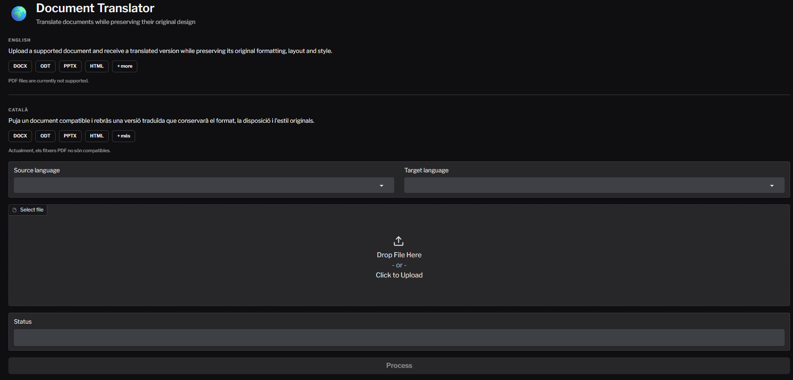

# SalamandraTA Document Translator

## Table of Contents

- [Description](#description)
- [Requirements](#requirements)
- [Setup](#setup)
- [Usage](#usage)
- [License](#license)

## Description
Translate document files [docx, pptx, xlsx, odt, etc.] using SalamandaraTA while keeping the formatting and style of the original file. 

## Requirements
- Git: To clone the repository.
- Docker: To run the container.
- Tikal [Okapi](https://okapiframework.org/).

## Setup

### Install Docker:
- Windows: [Guide](https://docs.docker.com/desktop/setup/install/windows-install/)
- Ubuntu: [Guide](https://docs.docker.com/engine/install/ubuntu/)

### Clone the Repository

Open your terminal and clone the project to your local machine.
```bash
git clone <REPOSITORY_URL>
cd <REPO_ROOT>
```

### Build Container:

The Dockerfile manages the complete setup process. Run this command in your terminal from the repository root.
```bash
docker build -t document-translator .
```
Once the docker container is built. You can run it using:
```bash
docker run -p 7860:7860 --rm -it document-translator
```
This will make the gradio app to be available at ```localhost:7860/```

Note: ```--rm``` removes the container after it is closed to cleanup space used by docker.

## Usage

- Goto ```localhost:7860/``` in browser. Then you should be at the app page below:



- From the page, select ```Source``` and ```Target``` languages from dropdowns. 
- Then drag and drop document to translate, or click and select the document to translate.
- Then click process.
- Once translation is done, the download button will appear on the right of the upload.

## License

This work is distributed under a [Apache License, Version 2.0](https://www.apache.org/licenses/LICENSE-2.0).


